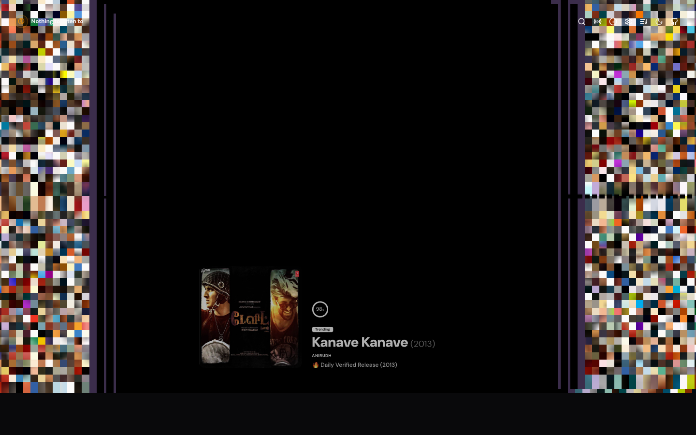
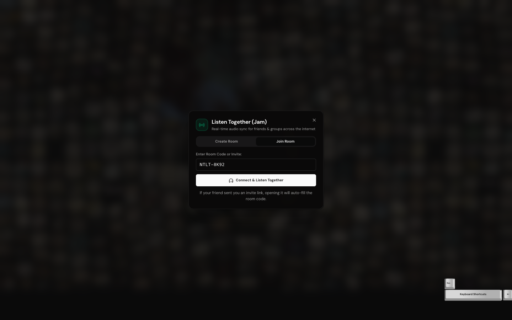
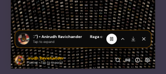

<div align="center">

# 🎵 Nothing to Listen to

**An immersive, ad-free WebGL 3D musical universe with real-time multi-user Jam sessions, custom playlists, lossless low-data streaming, and mobile lock-screen background playback.**

<br/>

[](https://kaushalboii.github.io/Nothing-to-listen-to/)
[](https://github.com/sponsors/kaushalboii)
[](https://www.typescriptlang.org/)
[](https://react.dev/)
[](https://www.khronos.org/webgl/)
[](https://vitest.dev/)
[](https://github.com/kaushalboii/Nothing-to-listen-to/actions)
[](LICENSE)

<br/>

[**🚀 Explore Live Universe**](https://kaushalboii.github.io/Nothing-to-listen-to/) &nbsp;•&nbsp; [**👥 Start a Jam Session**](https://kaushalboii.github.io/Nothing-to-listen-to/) &nbsp;•&nbsp; [**💖 Sponsor on GitHub**](https://github.com/sponsors/kaushalboii)

<br/><br/>

<!-- Real 3D Universe Showcase -->
<a href="https://kaushalboii.github.io/Nothing-to-listen-to/">
  
</a>

<p align="center"><em>Interactive, force-directed 3D Voronoi galaxy mapping 216 legendary vinyl albums across time, genres, and cultures.</em></p>

</div>

---

## 📑 Table of Contents

- [🌟 Overview](#-overview)
- [✨ Key Features](#-key-features)
  - [👥 Listen Together (Multi-User Group Jam Sessions)](#-listen-together-multi-user-group-jam-sessions)
  - [🎶 Custom Playlists (Max 3 with Unlimited Songs)](#-custom-playlists-max-3-with-unlimited-songs)
  - [💿 Interactive Navbar CD & 1-Tap Minimization](#-interactive-navbar-cd--1-tap-minimization)
  - [📱 Mobile Ultra-Performance & Desktop-Mode Optimization](#-mobile-ultra-performance--desktop-mode-optimization)
  - [🔒 Lock-Screen Background Playback & MediaSession](#-lock-screen-background-playback--mediasession-api)
  - [⚡ Lossless Low-Data Streaming & Smart Offline Caching](#-lossless-low-data-streaming--smart-offline-caching)
  - [🌐 Global Multi-Lingual Catalog (216 Masterpieces)](#-global-multi-lingual-catalog-216-masterpieces)
  - [🎧 Universal Multi-Platform Links](#-universal-multi-platform-links)
  - [🔎 Instant Search & Dual Filter System](#-instant-search--dual-filter-system)
- [⌨️ Keyboard Shortcuts](#️-keyboard-shortcuts)
- [🏗 Architecture & System Design](#-architecture--system-design)
- [📂 Project Structure](#-project-structure)
- [🚀 Quick Start](#-quick-start)
- [🔄 Automated Daily Releases Pipeline](#-automated-daily-releases--auto-deployment-pipeline)
- [💖 Support & Sponsor](#-support--sponsor)
- [🤝 Attribution & Credits](#-attribution--open-source-credits)
- [⚖️ License & Legal Disclaimer](#-license--legal-disclaimer)

---

## 🌟 Overview

**Nothing to Listen to** reimagines musical discovery as a tactile, force-directed 3D Voronoi visual sphere. Instead of scrolling through flat, algorithmic lists, songs are mapped across time and genre as interactive cells that pulsate, expand, and play directly in your browser without intrusive ads.

Whether you're craving classic rock legends, viral Bollywood melodies, explosive Kollywood mass anthems, high-energy Telugu blockbusters, soulful Malayalam indie gems, electrifying K-Pop choreography, or rhythmic Latin chart-toppers—**Nothing to Listen to** unites them into one fluid, ad-free canvas.

---

## ✨ Key Features

### 👥 Listen Together (Multi-User Group Jam Sessions)

<div align="center">
  
</div>

- **Multi-User Rooms (4+ Listeners)**: Connect with friends across any device or network with private 6-character room codes or 1-tap invite links.
- **Microsecond Precision Audio Phase-Lock**: Real-time WebSocket relay keeps everyone in exact synchrony with automatic network latency and drift compensation.
- **Collaborative DJ Mode with Smart Lock**: Host can toggle Collaborative DJ Mode ON/OFF:
  - When **ON**: Guests can freely play, pause, seek, and switch tracks.
  - When **OFF**: Guest controls lock cleanly with informative tooltips while host authority prevents accidental desync.
- **Floating Live Emoji Reactions**: Send animated floating reaction bubbles (❤️, 🔥, 🎵, ⚡, 💃, 🙌, ✨, 🎸) that burst across all connected screens with soundwave feedback.
- **Auto-Reconnection Watchdog**: Silent heartbeat checks automatically restore dropped mobile connections in the background without user intervention.

---

### 💿 Interactive Navbar CD & 1-Tap Minimization

<div align="center">
  
</div>

- **Spinning Vinyl CD Widget**: Active tracks show as an animated grooved vinyl record with real-time album artwork and rhythmic glow rings.
- **Scrolling Song Marquee**: Live ticker displays current title, artist, and playback status directly in the navigation bar.
- **1-Tap Minimize & Expand**: Swipe down on mobile or click the chevron button to tuck the player into the navbar CD without pausing audio; tap the CD anytime to bring it right back.

---

### 🎶 Custom Playlists (Max 3 with Unlimited Songs)
- **Create up to 3 Custom Playlists**: Organize your favorite songs into curated collections with custom names.
- **Unlimited Tracks per Playlist**: Add as many songs as you like with 1-tap from the player or galaxy view.
- **1-Click Play All & Queue Jump**: Play through an entire playlist seamlessly with automatic queue advance, or tap any track to jump right into it.
- **Full Playlist Management**: Rename, delete, and remove individual tracks anytime with persistent local storage.

---

### 📱 Mobile Ultra-Performance & Desktop-Mode Optimization
- **Dual Mode Optimization (Normal & Desktop-Mode on Mobile)**:
  - **Normal Mobile**: Clamped to 216-5,000 cells with 1.5 DPR for razor-sharp textures.
  - **Mobile in "Desktop Site" Mode**: Viewport-adaptive 2,500 cells and 1.0 DPR to prevent fragment shader overload on emulated desktop resolutions.
- **Physics Convergence Sleep**: Automatically throttles idle physics calculations when the pointer is stationary, eliminating phone heating and preserving 60 FPS battery life.
- **Zero-Jank Compositor Scrolling**: Mouse wheel and touch events use `{ passive: true }` listeners for zero scroll-blocking lag.
- **Automatic Background Sleep**: Drops render loop CPU/GPU consumption to **0%** when the device screen is locked or the tab is hidden.
- **Rock-Solid WebGL Context Recovery**: Guards against GPU context loss (`webglcontextlost`) so that the 3D galaxy seamlessly resumes upon unlocking your phone.

---

### 🔒 Lock-Screen Background Playback & MediaSession API
- **Continuous Lock-Screen Audio**: Music continues playing smoothly even when your phone screen is locked or the browser is minimized.
- **Native OS Media Controls**: Displays track title, artist name, and high-resolution album artwork on your iOS / Android lock screen and notification bar.
- **Hardware & Headphone Control**: Supports play, pause, previous track, next track, and scrubber seeking directly from headphone buttons and car Bluetooth dashboards.

---

### ⚡ Lossless Low-Data Streaming & Smart Offline Caching
- **100% Ad-Free Direct Streams**: Seamless high-fidelity direct audio streaming without pre-roll or mid-roll video ads.
- **Smart Data Saver Mode**: Automatically chooses 160kbps on 2G/3G/spotty mobile networks for 50% data savings, and 320kbps for audiophile lossless fidelity on broadband.
- **Zero-Network Instant Replays**: Integrates the native `CacheStorage` API to cache listened songs locally for immediate 0ms offline replays without re-downloading.
- **Intelligent Track Prefetching**: Automatically pre-fetches upcoming playlist tracks in the background for zero-buffering transitions.

---

### 🌐 Global Multi-Lingual Catalog (216 Masterpieces)

<details>
<summary><b>Click to expand catalog highlights by language & region</b></summary>
<br/>

- **Tamil**: Anirudh Ravichander (*Leo*, *Jailer*, *Vikram*, *Master*), A. R. Rahman (*Ponniyin Selvan*, *Roja*, *Alaipayuthey*), Harris Jayaraj, Yuvan Shankar Raja, Ilaiyaraaja (*Thalapathi*, *Nayagan*), Santhosh Narayanan (*Kabali*).
- **Hindi / Bollywood**: Arijit Singh (*Kesariya*, *Apna Bana Le*, *Tum Hi Ho*), A. R. Rahman (*Chaiyya Chaiyya*, *Kun Faya Kun*), Pritam, Vishal-Shekhar, Shankar-Ehsaan-Loy.
- **Telugu / Tollywood**: *RRR* (*Naatu Naatu*), *Pushpa* (*Oo Antava*, *Srivalli*), *Ala Vaikunthapurramuloo* (*Butta Bomma*), *Devara* (*Fear Song*, *Chuttamalle*), *Guntur Kaaram*, *Hi Nanna*.
- **Punjabi & Malayalam**: Diljit Dosanjh (*Lover*, *G.O.A.T.*, *Hass Hass*), AP Dhillon (*Brown Munde*, *Excuses*), Sidhu Moose Wala (*295*), Sushin Shyam (*Aavesham - Illuminati*, *Manjummel Boys*).
- **English / International Pop & Rock**: The Weeknd, Taylor Swift, Ed Sheeran, Harry Styles, Coldplay, Imagine Dragons, Queen, Nirvana, Linkin Park, Adele, Bruno Mars.
- **K-Pop & Asian Hits**: BTS (*Dynamite*, *Butter*), BLACKPINK (*DDU-DU DDU-DU*, *How You Like That*), NewJeans (*Super Shy*, *OMG*, *Ditto*), Stray Kids, Jung Kook, YOASOBI (*Idol*), LiSA (*Gurenge*).
- **Spanish & Latin**: Luis Fonsi (*Despacito*), Bad Bunny (*Tití Me Preguntó*, *Dákiti*), Shakira (*Waka Waka*, *Hips Don't Lie*, *Bzrp 53*), Rosalía, J Balvin.

</details>

---

### 🎧 Universal Multi-Platform Links
- Direct 1-click links for every song to stream on **Spotify**, **Apple Music**, **YouTube Music**, **JioSaavn**, **Amazon Music**, **Wynk Music**, **Gaana**, and **SoundCloud**.

---

### 🔎 Instant Search & Dual Filter System
- Press `Cmd + K`, `Ctrl + K`, or `/` anywhere to open the instant search modal.
- Real-time token matching across **Languages**, **Eras** (2020s, 2010s, 2000s, 1990s, Classics), and **Genres** (Pop, Rock, Soundtrack, Hip-Hop, Folk, EDM).
- Lazy evaluation ensures search filtering runs only while the modal is open, consuming zero idle CPU.

---

## ⌨️ Keyboard Shortcuts

| Shortcut | Action |
| :--- | :--- |
| `Cmd + K` / `Ctrl + K` or `/` | Open Instant Search & Filters modal |
| `Space` | Toggle Play / Pause |
| `Right Arrow` (`→`) | Skip to Next Song in Playlist |
| `Left Arrow` (`←`) | Return to Previous Song |
| `Esc` | Close search modal / player view / exit fullscreen |

---

## 🏗 Architecture & System Design

```text
┌────────────────────────────────────────────────────────────────────────┐
│                          User Interface Layer                          │
│   React 19  •  Tailwind CSS  •  Radix UI Primitives  •  Lucide Icons   │
└───────────────────────────────────┬────────────────────────────────────┘
                                    │
                         [ Zustand State Store ]
           (Active Track, Playlists, Jam Session, Visual Settings)
            │                       │                       │
            ▼                       ▼                       ▼
┌───────────────────────┐ ┌───────────────────┐ ┌────────────────────────┐
│  3D Graphics Engine   │ │  Audio Streaming  │ │  Real-Time Jam Sync    │
│  Voroforce (WebGL2)   │ │  Direct HTML5     │ │  WebSocket Relay       │
│  OGL 2.0 Shaders      │ │  Lossless Quality │ │  Microsecond Phase-Lock│
│  Worker Physics Forces│ │  CacheStorage 0ms │ │  Collaborative DJ Mode │
│  Idle Convergence     │ │  W3C MediaSession │ │  Live Floating Emojis  │
└───────────────────────┘ └───────────────────┘ └────────────────────────┘
```

---

## 📂 Project Structure

```
Nothing-to-listen-to/
├── app/
│   ├── cmps/                 # React UI Components
│   │   ├── common/           # Shared components (music-player, modal, settings)
│   │   ├── layout/           # Navbar, footer, interactive vinyl CD
│   │   ├── ui/               # Radix UI primitives & buttons
│   │   └── views/            # Modals (jam, playlists, search, favorites, about)
│   ├── services/             # Background services
│   │   ├── audio-cache.ts    # CacheStorage offline audio caching
│   │   └── jam-session.ts    # Multi-user WebSocket sync & DJ control
│   ├── store/                # Zustand global state slices
│   ├── utils/                # Audio, telemetry, and animation utilities
│   ├── vf/                   # Voroforce WebGL bindings & presets
│   └── main.tsx              # Application entry point
├── docs/assets/              # High-resolution screenshots & showcase previews
├── voroforce/                # 3D Voronoi WebGL2 physics & rendering engine
│   ├── controls/             # Camera, pointer, and wheel event handlers
│   ├── display/              # OGL renderer, shaders, and scene graph
│   └── simulation/           # Web Worker physics forces & lattice
├── scripts/
│   └── sync-music.py         # Daily music crawler & texture atlas generator
├── public/                   # Static assets, sitemaps, and icons
├── .github/workflows/        # Automated CI/CD & daily music sync crons
└── package.json              # Dependencies and scripts
```

---

## 🚀 Quick Start

### Prerequisites
- [Node.js](https://nodejs.org/) (version 18 or newer)
- Modern browser with WebGL 2.0 support (Chrome, Edge, Safari, Firefox)

### Installation
```bash
# Clone the repository
git clone https://github.com/kaushalboii/Nothing-to-listen-to.git
cd Nothing-to-listen-to

# Install dependencies
npm install

# Start development server
npm run dev
```

Visit `http://localhost:3000` in your browser.

### Testing & Verification
```bash
# Run unit and integration test suite (81 tests)
npm test

# Run TypeScript checks
npx tsc --noEmit

# Run Biome linter
npm run lint
```

### Production Build
```bash
# Compile TypeScript and bundle with Vite
npm run build

# Preview the production build locally
npm run preview
```

### Dynamic Daily Music Sync
```bash
# Fetch latest releases of today across all languages and rebuild 3D textures
npm run sync:music
```

---

## 🔄 Automated Daily Releases & Auto-Deployment Pipeline

1. **Daily Auto-Sync Cron (`.github/workflows/update-music.yml`)**:
   - Runs automatically 4 times every day (`0 0,6,12,18 * * *`).
   - Fetches live daily chart releases across **Apple Music** (Tamil, Hindi, Telugu, Punjabi, Malayalam), **Global/US**, **Japan**, **Latin America**, and **Saavn New Releases**.
   - Resolves verified official video IDs, downloads 600x600 high-resolution artwork, and rebuilds the WebGL compressed texture atlas.
   - Automatically commits updates to `main` with verified author credentials to maintain daily GitHub contribution activity.
2. **Push CI/CD Deployment (`.github/workflows/deploy.yml`)**:
   - Runs on every push to `main`, validating all 81 tests and deploying production builds to GitHub Pages with zero downtime.

---

## 💖 Support & Sponsor

If you enjoy **Nothing to Listen to** and want to support ongoing server-free development, new features, and daily music sync pipelines, consider becoming a sponsor!

<div align="center">

<table align="center" style="border-collapse: collapse;">
  <tr>
    <td align="center" style="padding: 24px; border: 1px solid #30363d; border-radius: 12px; background: #0d1117;">
      <a href="https://github.com/sponsors/kaushalboii" target="_blank">
        
        <br /><br />
        
      </a>
      <p style="margin-top: 14px; color: #c9d1d9; font-size: 15px;"><strong>Support Nothing to Listen to & Open-Source Music Innovation</strong></p>
      <p style="color: #8b949e; font-size: 13px; max-width: 520px; line-height: 1.5;">Your sponsorship helps fund serverless infrastructure, ad-free streaming, low-data mobile optimizations, real-time shared Jam audio sync, custom playlists, and automated daily music release pipelines.</p>
    </td>
  </tr>
</table>

<br/>

[](https://github.com/sponsors/kaushalboii)

</div>

---

## 🤝 Attribution & Open-Source Credits

This project was inspired by and built upon the open-source architecture of [Nothing to Watch](https://github.com/gnovotny/nothing-to-watch), conceived and developed by [Gabriel Novotny](https://github.com/gnovotny).

We express our gratitude to the original creators for open-sourcing their force-directed Voronoi visualization engine under the permissive **MIT License**.

---

## ⚖️ License & Legal Disclaimer

### License
This project is open source and available under the terms of the [MIT License](LICENSE).

### Content & Streaming Disclaimer
- **Nothing to Listen to** is a non-commercial, educational, and personal open-source project designed for musical discovery.
- **No media files are hosted**: This web application does not store, host, or distribute any copyrighted MP3, AAC, MP4, or video files on its servers.
- **Official Public Embeds & Streams**: Playback leverages official, publicly available streams and privacy-enhanced YouTube embeds (`youtube-nocookie.com`).
- **External Links**: Streaming links point directly to public search endpoints on authorized third-party services (Spotify, Apple Music, YouTube Music, JioSaavn, Amazon Music, Wynk, Gaana, and SoundCloud).
- All copyrights, trademarks, artwork, and song rights belong exclusively to their respective artists, composers, and record labels.

---

<div align="center">

### 📬 Contact & Feedback

For questions, feedback, or suggestions:  
📧 **Email**: [contact.nothingtolisten@gmail.com](mailto:contact.nothingtolisten@gmail.com) &nbsp;•&nbsp; 🐙 **GitHub**: [@kaushalboii](https://github.com/kaushalboii) &nbsp;•&nbsp; 💖 **Sponsor**: [github.com/sponsors/kaushalboii](https://github.com/sponsors/kaushalboii)

</div>
